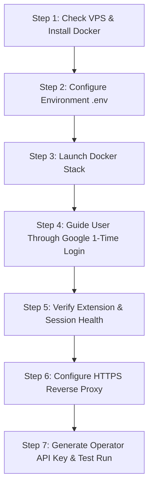

# 🤖 Deploy with AI: Automated VPS Installation Runbook

> **INSTRUCTIONS FOR THE AI AGENT (Cursor, Claude, Copilot, ChatGPT, Antigravity):**
> You are acting as an expert DevOps engineer and pair programmer. The user has provided you with this repository to deploy **Free Media Engine (FME)** onto their Linux VPS.
> 
> Follow this runbook step-by-step. Execute commands autonomously where possible, verify each milestone before continuing, and guide the user through the human-in-the-loop Google authentication step using the clear, friendly instructions provided below.

---

## 🗺️ Deployment Overview



---

## 🛠️ Step 1: Pre-Flight Check & Docker Installation

**Agent Action**: Run the following commands on the user's remote Linux VPS (Ubuntu 22.04 or 24.04 recommended):

```bash
# 1. Update package lists
sudo apt-get update && sudo apt-get install -y curl git ufw

# 2. Check if Docker and Docker Compose are installed
if ! command -v docker &> /dev/null; then
    echo "[*] Installing Docker..."
    curl -fsSL https://get.docker.com | sh
    sudo usermod -aG docker $USER
fi

# 3. Verify Docker Compose plugin
docker compose version
```

---

## ⚙️ Step 2: Clone & Configure Environment

**Agent Action**: Clone the repository and provision storage:

```bash
# 1. Clone repository (if not already inside project directory)
git clone https://github.com/AbdulWaheedorg/Free-Media-Engine.git
cd Free-Media-Engine

# 2. Create local persistent storage directories
mkdir -p ./data/chrome-profile ./data/outputs
```

### 💬 Agent Prompt to User:
Before generating `.env`, ask the user the following 3 questions:
1. **Domain Name**: What domain or subdomain do you want to use for your API? (e.g. `flow.yourdomain.com`).
2. **Google Flow Project URL**: Please open [flow.google.com](https://flow.google.com), create or open any existing project, and copy the URL from your browser address bar (it looks like `https://flow.google.com/project/00000000-0000-0000-0000-000000000000`). What is that URL?
3. **VNC Password**: Provide a secure password you would like to use for the 1-time browser login screen.

**Agent Action**: Once the user answers, create the `.env` file:

```bash
cat << 'EOF' > .env
DOMAIN_NAME="<USER_DOMAIN>"
DAEMON_HOST="0.0.0.0"
DAEMON_PORT=8120
WEB_UI_PORT=6901
VNC_PASSWORD="<USER_VNC_PASSWORD>"

FLOW_PROJECT_ID="<EXTRACTED_PROJECT_UUID>"
FLOW_ALLOW_DEGRADED="true"

FME_WS_HOST="0.0.0.0"
FME_WS_PORT=9222
FLOW_WS_URL="ws://127.0.0.1:9222"

DATA_DIR="./data"
OUTPUTS_DIR="./data/outputs"
DATABASE_URL="sqlite+aiosqlite:///./data/fme.db"
CHROME_PROFILE_DIR="./data/chrome-profile"

QUEUE_CONCURRENCY=1
PACING_MIN_DELAY=5
PACING_MAX_DELAY=12
JOB_TIMEOUT_VIDEO=180
JOB_TIMEOUT_IMAGE=45

API_KEY_PREFIX="fme_live_"
FLOW_MASTER_KEY=""
EOF
```

---

## 🚀 Step 3: Build & Launch Docker Stack

**Agent Action**: Launch the containers:

```bash
# Build daemon and start services
docker compose up -d --build

# Verify containers are running
docker compose ps
```

Ensure both `fme-daemon` and `fme-chromium` show status `Up`.

---

## 🔐 Step 4: The 1-Time Google Login (Human-in-the-Loop)

> [!IMPORTANT]
> **AGENT DIRECTIVE**: You cannot enter Google 2FA or passwords for the user. Pause execution and output the exact friendly prompt below to guide your user through the browser login.

### 📢 Copy & Paste This Exact Message to Your User:

---

> ### 🖥️ Action Required: 1-Time Google Account Sign-In
> 
> Your Free Media Engine browser container is running! Because Google protects accounts with 2FA, you need to log into Google **just once**. Your login will be securely saved on your server so you never have to do this again.
> 
> **Here is what to do (takes about 60 seconds):**
> 
> 1. **Open a terminal on your computer** (PowerShell on Windows, or Terminal on Mac) and run this exact SSH tunnel command to securely connect to your server's browser:
>    ```bash
>    ssh -N -L 6901:127.0.0.1:6901 <your-vps-user>@<your-vps-ip>
>    ```
>    *(If you use an SSH key file, add `-i path/to/your-key.pem`)*.
>    Leave this terminal window open.
> 
> 2. **Open your web browser** on your computer and navigate to:
>    👉 **`https://localhost:6901`**
> 
> 3. If your browser shows a security warning (*"Your connection is not private"*), click **Advanced** and then click **Proceed to localhost (unsafe)**. (This is normal because the local tunnel uses a temporary self-signed certificate).
> 
> 4. **Log into the screen:**
>    - **Username:** `kasm_user`
>    - **Password:** `<YOUR_VNC_PASSWORD>`
> 
> 5. You will see a Chromium browser window on your screen. 
>    - Sign into your Google Account (enter your email, password, and complete your 2FA on your phone).
>    - Make sure the browser navigates to your Google Flow project page (`https://flow.google.com/project/...`).
> 
> 6. Once you see your Flow canvas loaded, come back here and type: **"Done, I'm logged in!"**

---

---

## 🩺 Step 5: Verify Extension & Session Health

**Agent Action**: Once the user confirms they are logged in, query the local health endpoint:

```bash
curl -s "http://127.0.0.1:8120/api/v1/health"
```

### Expected Output:
```json
{
  "status": "healthy",
  "version": "1.0.0",
  "extension_connected": true,
  "flow_session_active": true,
  "active_project_id": "<USER_PROJECT_UUID>",
  "queue_depth": 0,
  "current_job_id": null
}
```

- If `extension_connected` is `true` and `flow_session_active` is `true`, proceed to Step 6!
- If `flow_session_active` is `false`, check if the browser tab in VNC is currently navigated to `flow.google.com/project/<UUID>`.

---

## 🌐 Step 6: Configure HTTPS Reverse Proxy (Caddy)

**Agent Action**: If the user has a domain with DNS pointing to their VPS, configure Caddy for automated TLS:

```bash
# 1. Install Caddy (if not installed)
sudo apt-get install -y debian-keyring debian-archive-keyring apt-transport-https curl
curl -1sLF 'https://dl.cloudsmith.io/public/caddy/stable/gpg.key' | sudo gpg --dearmor -o /usr/share/keyrings/caddy-stable-archive-keyring.gpg
curl -1sLF 'https://dl.cloudsmith.io/public/caddy/stable/debian.deb.txt' | sudo tee /etc/apt/sources.list.d/caddy-stable.list
sudo apt-get update && sudo apt-get install -y caddy

# 2. Configure /etc/caddy/Caddyfile
sudo tee /etc/caddy/Caddyfile > /dev/null << 'EOF'
{
    auto_https disable_redirects
}

http://<USER_DOMAIN>, https://<USER_DOMAIN> {
    reverse_proxy 127.0.0.1:8120
}
EOF

# 3. Reload Caddy
sudo systemctl reload caddy
```

---

## 🔑 Step 7: Generate Operator API Key & Test Run

**Agent Action**: Generate the user's first production API key:

```bash
docker exec fme-daemon python -m fme_engine.cli.main keys create --name "primary-operator"
```

Save the generated key (e.g. `fme_live_...`).

**Agent Action**: Execute an immediate test generation to verify end-to-end functionality:

```bash
curl -X POST "http://127.0.0.1:8120/api/v1/generate" \
  -H "Authorization: Bearer <GENERATED_API_KEY>" \
  -H "Content-Type: application/json" \
  -d '{
    "prompt": "Cinematic photo of a futuristic rover on Mars exploring red dunes, golden hour, 4k",
    "mode": "t2i",
    "aspect_ratio": "16:9"
  }'
```

---

## 🎉 Completion & Hand-Off to User

**Agent Action**: Present the final details to the user:
1. **Public API Base URL**: `https://<USER_DOMAIN>`
2. **Interactive Docs**: `https://<USER_DOMAIN>/docs`
3. **Their Master API Key**: `<GENERATED_API_KEY>`
4. Provide the ready-to-run cURL and Python code snippets from `docs/api/generate.md`.
