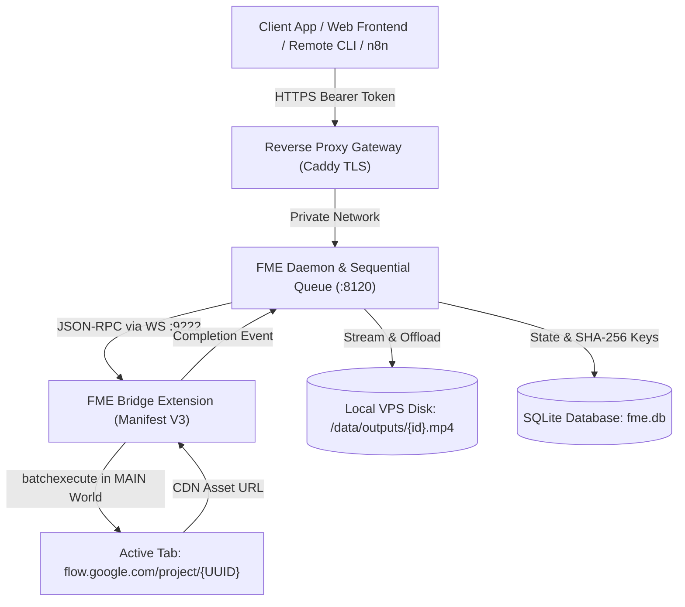

<div align="center">

# 🎬 Free Media Engine (FME)

### *Self-Hosted REST API Gateway & Automation Engine for Google Flow*

[](https://www.python.org/)
[](https://fastapi.tiangolo.com/)
[](https://www.docker.com/)
[](LICENSE)
[](#-architecture--how-it-works)
[](https://flow.google.com/)
[](#-why-free-media-engine)

<p align="center">
  <a href="#-what-is-this-in-10-seconds">What Is This?</a> •
  <a href="#-why-free-media-engine">Why FME?</a> •
  <a href="#-deploy-with-an-ai-agent-in-5-minutes">Deploy with AI</a> •
  <a href="#-30-second-quickstart-examples">Quickstart</a> •
  <a href="docs/api/overview.md">API Reference</a> •
  <a href="#-architecture--how-it-works">Architecture</a> •
  <a href="#-roadmap--integrations">Roadmap</a>
</p>

</div>

---

## 💡 What Is This in 10 Seconds?

**Free Media Engine (FME)** turns **Google Flow (`flow.google.com`)** into your own private, self-hosted **AI Video & Image Generation REST API**.

* **The Problem**: Google Flow generates incredible videos and 2K images powered by **Gemini Omni 1.1 Flash** and **Veo**. However, Google provides **no public API** for Flow, and traditional automated tools (Puppeteer, Playwright, Selenium) fail immediately due to canvas fingerprinting, ambient session tokens, and reCAPTCHA bot challenges.
* **The Solution**: FME deploys a real, unmodified browser in an isolated virtual display on your Linux VPS. An extension bridge executes generation transactions natively from the browser's own event loop, completely avoiding bot detection.
* **What You Get**: A secure, authenticated REST API gateway (`POST /api/v1/generate`) that you can call from **n8n workflows**, **Discord/Telegram bots**, **mobile apps**, **Python scripts**, or **web frontends** to produce high-definition MP4 videos and PNG images on demand.

---

## ⚡ Why Free Media Engine?

| Dimension | Official Google API | Headless Puppeteer / Playwright | 🎬 **Free Media Engine (FME)** |
| :--- | :---: | :---: | :---: |
| **Public API Availability** | ❌ None (No public API exists) | ❌ Script scraping breaks constantly | ✅ **Production-grade REST API** |
| **Bot Telemetry & reCAPTCHA** | N/A | ❌ Detected and blocked via CDP flags | ✅ **100% Headed Native Execution (Zero CDP flags)** |
| **Authentication & Security** | N/A | ❌ Insecure hardcoded tokens | ✅ **Hashed Bearer keys with $<50\text{ms}$ instant revocation** |
| **Job Queue & Account Safety** | N/A | ❌ Concurrent requests corrupt session | ✅ **Single-worker sequential queue with jitter pacing** |
| **Asset Persistence** | N/A | ⚠️ Ephemeral Google CDN links expire | ✅ **Streamed directly to local server disk storage** |
| **Real-Time Status Updates** | N/A | ❌ Blind manual polling | ✅ **Server-Sent Events (SSE) live progress stream** |
| **Video Playback & Scrubbing** | N/A | ❌ Must download entire file | ✅ **RFC 7233 HTTP Byte-Range streaming** |

---

> ### 🤖 Deploy with an AI Agent in 5 Minutes!
> **Have an AI coding assistant like Cursor, Claude Code, GitHub Copilot, or Antigravity?**
> You don't need to manually configure Docker, Caddy, or servers. Just give your AI agent this repository link and point it to:
> 
> 👉 **[DEPLOY_WITH_AI.md](DEPLOY_WITH_AI.md)** 👈
> 
> The AI agent will autonomously install Docker on your VPS, start the containers, guide you through a friendly 1-time Google 2FA login, verify your health check, and issue your master API key.

---

## ✨ Features & Capabilities

- 🎥 **Text-to-Video (`t2v`)**: Generative video synthesis powered by **Gemini Omni 1.1 Flash** and **Veo** (4s, 6s, 8s, 10s durations, 16:9 and 9:16 aspect ratios).
- 🖼️ **Image-to-Video (`i2v`)**: First-frame animation and seamless first-and-last frame visual morphing.
- 📸 **Text-to-Image (`t2i`)**: High-resolution 2K photographic master renders.
- 🎭 **Character Consistency**: Reference image anchors preserving actor likeness and clothing across multiple scene cuts.
- ⚡ **Real-Time Streaming (SSE)**: Server-Sent Events (`/jobs/{id}/stream`) emitting real-time progress updates without client-side polling.
- 🎞️ **RFC 7233 Range Streaming**: Fast, authenticated media delivery supporting byte-range scrubbing in modern HTML5 video players (`/assets/{id}`).
- 🛡️ **Anti-Abuse Rate Pacing**: Strict single-worker sequential queue (`concurrency = 1`) with $5\text{s}$–$12\text{s}$ pseudo-random jitter delay to prevent account rate-limiting.
- 🔑 **Dynamic Key Management**: Constant-time SHA-256 token verification (`fme_live_...`) with instant revocation ($<50\text{ms}$) and zero downtime.
- 🔒 **Zero Direct Exposure**: Chromium, the internal WebSocket bridge (`:9222`), and VNC (`:6901`) bind locally. Only reverse proxy TLS (port 443) is public.

---

## 💻 30-Second Quickstart Examples

### 1. cURL (Generate Video)
```bash
curl -X POST "https://flow.yourdomain.com/api/v1/generate" \
  -H "Authorization: Bearer <YOUR_FME_API_KEY>" \
  -H "Content-Type: application/json" \
  -d '{
    "prompt": "Cinematic aerial shot of a futuristic cyberpunk city in the rain, neon reflections, 4k",
    "mode": "t2v",
    "model": "omni_flash",
    "duration": 8,
    "aspect_ratio": "16:9"
  }'
```

**Response (202 Accepted):**
```json
{
  "job_id": "9b1deb4d-3b7d-4bad-9bdd-2b0d7b3dcb6d",
  "status": "QUEUED",
  "queue_position": 1,
  "stream_url": "/api/v1/jobs/9b1deb4d-3b7d-4bad-9bdd-2b0d7b3dcb6d/stream"
}
```

### 2. Python SDK
```python
import time
import requests

API_KEY = "fme_live_your_api_key_here"
BASE_URL = "https://flow.yourdomain.com/api/v1"
HEADERS = {"Authorization": f"Bearer {API_KEY}"}

# 1. Submit Generation Request
payload = {
    "prompt": "Hyper-realistic macro shot of a dewdrop on a neon flower petal",
    "mode": "t2i",
    "aspect_ratio": "16:9"
}
job = requests.post(f"{BASE_URL}/generate", headers=HEADERS, json=payload).json()
job_id = job["job_id"]
print(f"[*] Job queued: {job_id}")

# 2. Poll until complete (or use SSE /stream)
while True:
    status_resp = requests.get(f"{BASE_URL}/jobs/{job_id}", headers=HEADERS).json()
    print(f"[*] Status: {status_resp['status']} | Progress: {status_resp.get('progress', 0)}%")
    if status_resp["status"] == "COMPLETED":
        download_url = status_resp["download_url"]
        break
    time.sleep(3)

# 3. Stream and save locally
with requests.get(f"{BASE_URL}{download_url}", headers=HEADERS, stream=True) as r:
    with open("output.png", "wb") as f:
        for chunk in r.iter_content(chunk_size=8192):
            f.write(chunk)
print("[✓] Asset saved to output.png!")
```

### 3. JavaScript / Node.js
```javascript
const API_KEY = "fme_live_your_api_key_here";
const BASE_URL = "https://flow.yourdomain.com/api/v1";

async function generateVideo() {
  const res = await fetch(`${BASE_URL}/generate`, {
    method: "POST",
    headers: {
      "Authorization": `Bearer ${API_KEY}`,
      "Content-Type": "application/json"
    },
    body: JSON.stringify({
      prompt: "Golden hour drone flyover of ocean waves crashing onto black sand beach",
      mode: "t2v",
      model: "omni_flash",
      duration: 6,
      aspect_ratio: "16:9"
    })
  });
  const data = await res.json();
  console.log("Job Submitted:", data);
}

generateVideo();
```

---

## 🏛 Architecture & How It Works

FME uses the **Hybrid Relay Pattern** across four isolation tiers:



1. **Gateway**: Terminates public HTTPS and enforces rate limiting.
2. **Daemon**: Schedules jobs sequentially, hashes API keys, manages jitter pacing, and stores completed media.
3. **Chromium in Virtual Frame**: Headed browser holding persistent Google cookies and profile data on durable storage.
4. **Local Bridge**: Extension running in the page's `MAIN` execution context that executes Google Flow's internal `batchexecute` transactions natively.

---

## 🚀 Self-Hosting Setup (Docker Compose)

### 1. Clone & Setup Configuration
```bash
git clone https://github.com/AbdulWaheedorg/Free-Media-Engine.git
cd Free-Media-Engine

# Copy template configuration
cp .env.example .env
```

Edit `.env` and set:
- `FLOW_PROJECT_ID`: The UUID from your Google Flow workspace URL (`flow.google.com/project/<UUID>`).
- `DOMAIN_NAME`: Your domain or VPS IP (e.g., `flow.example.com`).
- `VNC_PASSWORD`: A secure password for the browser screen.

### 2. Launch Stack
```bash
docker compose up -d --build
```

### 3. Log into Google (1-Time Setup)
Create a secure SSH port-forward tunnel from your local computer:
```bash
ssh -N -L 6901:127.0.0.1:6901 user@your-vps-ip
```
Open **`https://localhost:6901`** in your browser:
- **Username**: `kasm_user`
- **Password**: Your `VNC_PASSWORD`

Sign into your Google account inside Chromium and open your Flow project. Your session is saved to `./data/chrome-profile` permanently.

### 4. Create Your First API Key
```bash
docker exec fme-daemon python -m fme_engine.cli.main keys create --name "my-app"
```

---

## 🗺️ Roadmap & Integrations

- [ ] **n8n Community Node**: Drop-in workflow automation block for scheduled video generation.
- [ ] **ComfyUI Custom Node**: Directly pipe Flow outputs into local ComfyUI upscalers and post-processing.
- [ ] **Telegram & Discord Bot Starter**: Production-ready open-source bot templates for community creation.
- [ ] **Outbound Webhook Callbacks**: Push completion payloads directly to external URLs upon render finish.
- [ ] **Multi-Project Workspace Load Balancing**: Round-robin job dispatch across multiple Google Flow project workspaces.

---

## 📚 Complete Documentation Index

| Guide | Description |
| :--- | :--- |
| 🤖 [**Deploy with AI**](DEPLOY_WITH_AI.md) | Autonomous installation runbook for Cursor, Claude, Copilot, & Antigravity. |
| 🌐 [**API Overview & Auth**](docs/api/overview.md) | Bearer tokens, constant-time verification, concurrency, and lifecycle states. |
| 🎥 [**Generation Endpoints**](docs/api/generate.md) | Complete schemas, modes (`t2v`, `t2i`, `i2v`), durations, and aspect ratios. |
| ⚡ [**Job Polling & SSE Streaming**](docs/api/jobs.md) | Real-time progress updates via Server-Sent Events and job status polling. |
| 📦 [**Binary Asset Streaming**](docs/api/assets.md) | RFC 7233 HTTP Range requests, video scrubbing, and embedding in HTML. |
| 🎭 [**Character Consistency**](docs/api/characters.md) | Actor reference anchors and persistent multi-scene identity. |
| 🎬 [**Scene Composition**](docs/api/scenes.md) | Multi-shot storyboards, scene timelines, and stitched video sequences. |
| 🔑 [**API Key Management**](docs/api/admin-keys.md) | Dynamic key issuing, instant revocation (<50ms), and CLI administration. |
| 🏛️ [**Architecture Deep Dive**](docs/development/architecture.md) | In-depth analysis of the 4 isolation tiers and security invariants. |
| 🛠️ [**Extension Internals**](docs/development/extension-internals.md) | MAIN world DOM injection, `batchexecute` RPCs, and WebSocket protocol. |

---

## 🤝 Contributing

We welcome contributions from the community! Please read our [CONTRIBUTING.md](CONTRIBUTING.md) guide before submitting pull requests.

---

## 📄 License

Free Media Engine is released under the [MIT License](LICENSE).
