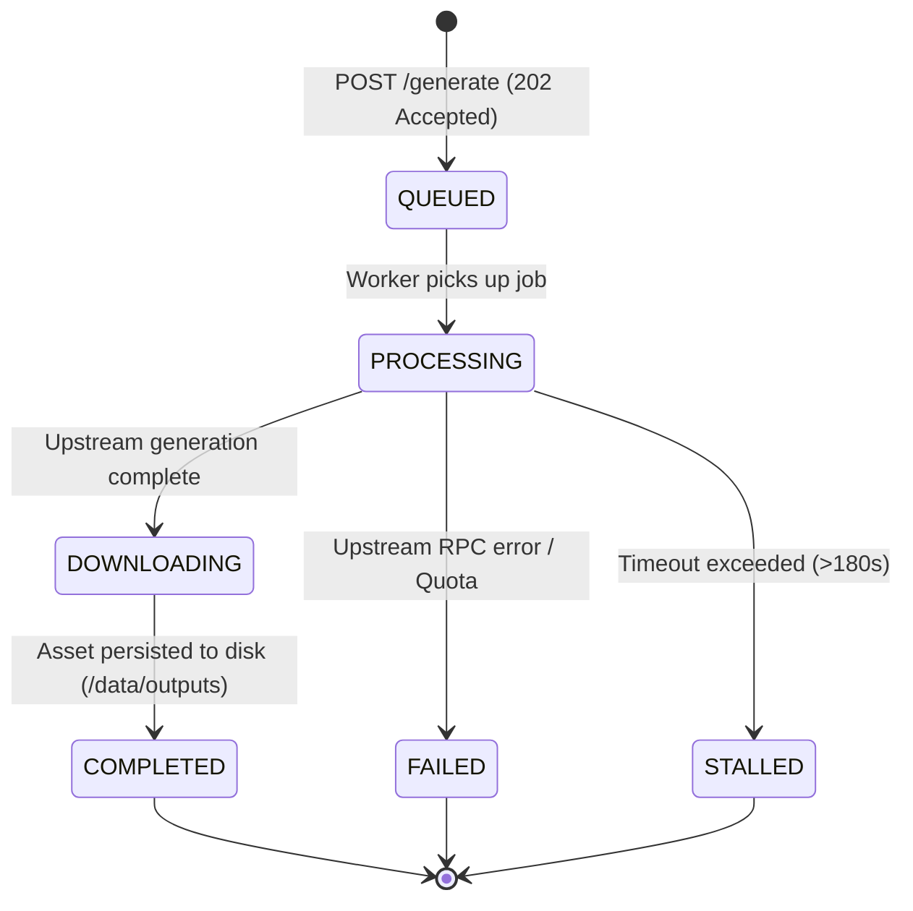

# API Overview & Authentication

The Free Media Engine (FME) REST API provides a unified, authenticated interface for dispatching generative video and image rendering jobs, monitoring queue status in real time, and streaming finished media directly to client applications.

---

## 🌐 Base URLs

| Environment | Base URL | Protocol | Port |
| :--- | :--- | :--- | :--- |
| **Production** | `https://flow.yourdomain.com/api/v1` | HTTPS (TLS 1.3) | `443` |
| **Local / Docker** | `http://127.0.0.1:8120/api/v1` | HTTP | `8120` |

### Interactive Documentation
- **Swagger UI**: [`https://flow.yourdomain.com/docs`](https://flow.yourdomain.com/docs)
- **ReDoc UI**: [`https://flow.yourdomain.com/redoc`](https://flow.yourdomain.com/redoc)
- **OpenAPI Schema**: [`https://flow.yourdomain.com/openapi.json`](https://flow.yourdomain.com/openapi.json)

---

## 🔑 Authentication

Every API call (with the sole exception of the public `/health` endpoint) requires an authorized Bearer token passed in the standard HTTP `Authorization` header:

```http
Authorization: Bearer <YOUR_FME_API_KEY>
```

### Key Format & Security Invariants
1. **Entropy & Prefix**: Keys are 256-bit random alphanumeric tokens prefixed with `fme_live_` for immediate auditability in code and log parsers.
2. **Zero Plaintext Storage**: The database only stores a cryptographic SHA-256 hash (`key_hash`) along with a public 8-character identifier (`key_prefix`).
3. **Timing Attack Protection**: Key verification uses Python's `hmac.compare_digest()` constant-time string comparison.
4. **Instant Revocation**: If a key is revoked, subsequent API requests with that key fail with `401 Unauthorized` in $<50\text{ms}$ without interrupting background queue workers or restarting the server.
5. **Emergency Master Key**: If configured in `.env`, `FLOW_MASTER_KEY` allows administrative access even during database maintenance.

---

## 🚦 Queue & Concurrency Model

Due to Google Flow's internal architecture, batch RPCs cannot be safely submitted in parallel within a single browser workspace. To ensure 100% session longevity and prevent anti-abuse detection, FME enforces the following invariants:

1. **Single-Worker Sequential Queue (`concurrency = 1`)**: All incoming generation requests are acknowledged with `202 Accepted` and assigned a FIFO position in the queue.
2. **Artificial Jitter Delay ($5\text{s}$ to $12\text{s}$)**: Between consecutive jobs, the queue worker introduces a pseudo-random delay to simulate realistic human dispatch behavior.
3. **Execution Timeouts**:
   - **Images (`t2i`)**: 45-second timeout.
   - **Videos (`t2v`, `i2v`)**: 180-second timeout.
   If a job exceeds its timeout, it transitions to `STALLED` and the browser supervisor resets the active canvas tab.

---

## 🔄 Job Lifecycle State Machine



### State Definitions

| Status | Description | Action Required |
| :--- | :--- | :--- |
| `QUEUED` | The job is waiting in the sequential queue. | Poll status or listen via SSE stream. |
| `PROCESSING` | The browser extension is actively orchestrating generation in Google Flow. | Keep waiting; do not re-submit. |
| `DOWNLOADING` | Generation is finished; the daemon is streaming media to local VPS disk. | Asset will be available in seconds. |
| `COMPLETED` | The media file is fully downloaded and verified on disk. | Download asset from `/api/v1/assets/{job_id}`. |
| `FAILED` | An error occurred (e.g., prompt violation or quota issue). | Inspect `error_message` in the response. |
| `STALLED` | Job exceeded the timeout without completing. | Automatic browser tab refresh triggered. |

---

## 📡 System Health Check

Before submitting bulk jobs or integrating external automated workflows, clients can query the `/health` endpoint:

```bash
curl -X GET "https://flow.yourdomain.com/api/v1/health"
```

### Response (200 OK)
```json
{
  "status": "healthy",
  "version": "1.0.0",
  "extension_connected": true,
  "flow_session_active": true,
  "active_project_id": "00000000-0000-0000-0000-000000000000",
  "queue_depth": 0,
  "current_job_id": null,
  "uptime_seconds": 1245.8
}
```

#### Health Fields
- `extension_connected`: Confirms the Chrome extension WebSocket bridge is active on port 9222.
- `flow_session_active`: Confirms the browser is currently located inside the pinned Google Flow workspace URL.
- `queue_depth`: Number of jobs currently pending in `QUEUED` state.
- `current_job_id`: UUID of the job currently in `PROCESSING` state (or `null` if idle).
